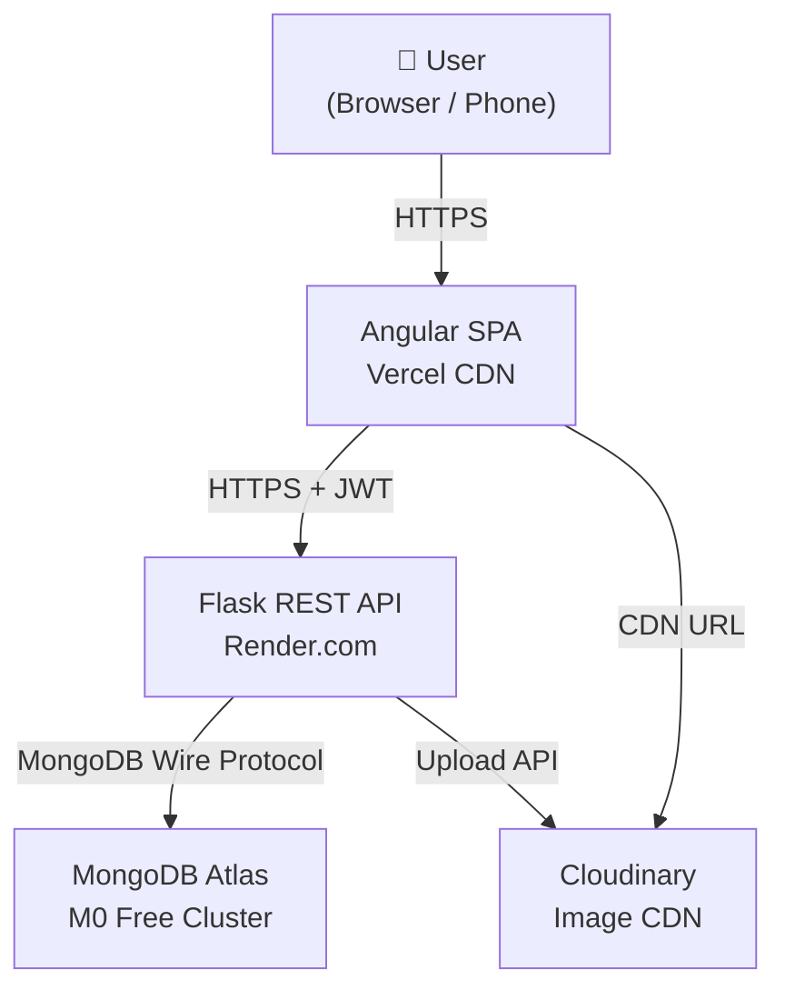
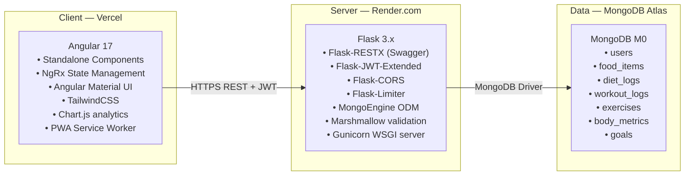
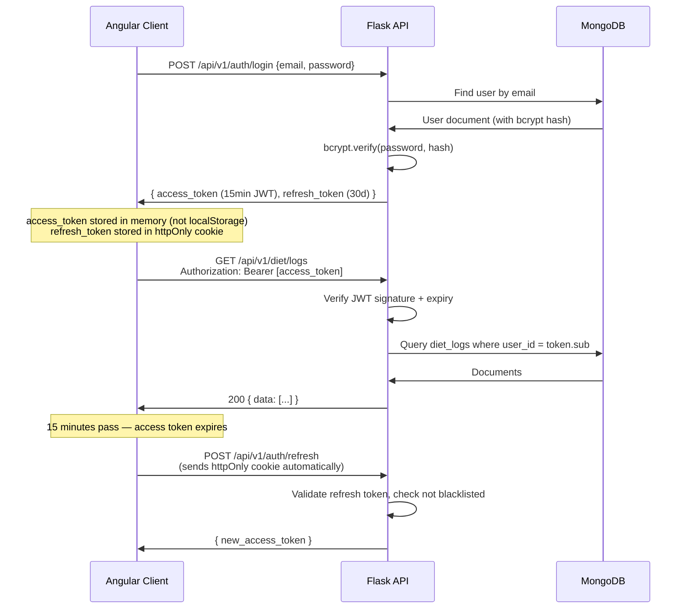
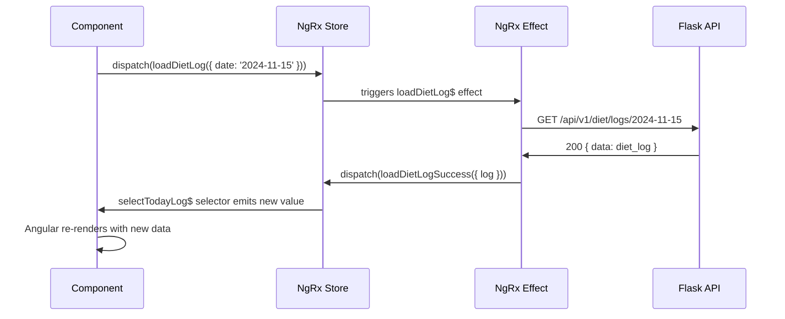
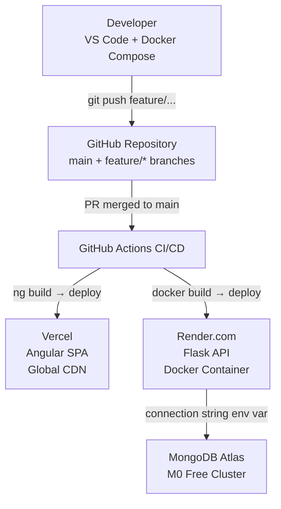

# FitTrack — System Architecture

> Read this document before writing any code. For each section, ask yourself: *Why this design? What would I say if asked about this in a system design interview?*

---

## System Context (Highest Level View)



**Interview talking point:** This is a classic **3-tier architecture** — Presentation (Angular), Application (Flask), Data (MongoDB). Frontend and backend are deployed independently, so they can scale separately. The SPA is served from a CDN (fast everywhere), and the API is a separate service (stateless, horizontally scalable).

---

## Container Diagram



---

## Authentication Flow



**Why memory storage for access tokens (not localStorage)?**
localStorage is readable by any JavaScript running on the page — including malicious injected scripts (XSS). Memory is cleared on page refresh and is not accessible to other scripts.

**Why httpOnly cookie for refresh tokens?**
httpOnly cookies cannot be read by JavaScript at all. They are sent automatically by the browser on matching requests. This protects the long-lived refresh token from XSS.

**Questions to research:**
- What is CSRF and how does `SameSite=Strict` on cookies prevent it?
- What is token blacklisting and when is it needed for logout?
- What is the difference between `Authentication` and `Authorization`?
- How does OAuth 2.0 differ from this custom JWT approach?

---

## Request Lifecycle (Middleware Chain)

Every API request passes through this chain before reaching your route handler:

```
Incoming Request
       ↓
CORS Middleware           — checks Origin header, allows/blocks cross-origin requests
       ↓
Rate Limiter              — 100 req/min per IP (Flask-Limiter)
       ↓
JWT Validation            — verifies token signature + expiry (@jwt_required)
       ↓
Input Validation          — validates request body against Marshmallow schema
       ↓
Route Handler             — thin: calls service, returns response
       ↓
Service Layer             — business logic lives here (calorie calc, aggregations)
       ↓
MongoEngine Model         — database operations
       ↓
MongoDB Atlas
```

**Why a service layer?**
Route handlers should only do 3 things: parse input, call a service, return a response. Business logic (calorie calculations, streak computation, report aggregation) belongs in a separate service layer. This makes logic reusable and testable independently of HTTP.

```
# Wrong — business logic in the route
@diet_ns.route('/logs')
class DietLogs(Resource):
    def post(self):
        data = request.json
        total_calories = sum(item['quantity'] * get_food_calories(item['food_id']) / 100
                             for item in data['entries'])  # ← logic in route (bad)
        ...

# Right — thin route, logic in service
@diet_ns.route('/logs')
class DietLogs(Resource):
    def post(self):
        data = diet_log_schema.load(request.json)
        log = diet_service.create_or_update_log(current_user.id, data)
        return {'data': log.to_dict()}, 201
```

---

## Frontend Architecture

```
src/app/
├── core/                          ← Singleton services, loaded once
│   ├── auth/
│   │   ├── auth.service.ts        ← Token management, login/logout
│   │   └── jwt.interceptor.ts     ← Attaches Bearer token to every request
│   ├── guards/
│   │   └── auth.guard.ts          ← Redirects unauthenticated users to /login
│   └── interceptors/
│       └── error.interceptor.ts   ← Global HTTP error handling (401 → refresh)
│
├── shared/                        ← Reusable, stateless components
│   ├── components/
│   │   ├── macro-card/            ← Macro display card (protein/carbs/fat)
│   │   ├── progress-ring/         ← Circular progress indicator
│   │   └── chart-wrapper/         ← Chart.js wrapper component
│   └── pipes/
│       └── calories.pipe.ts       ← Format calorie display
│
├── features/                      ← Lazy-loaded feature areas
│   ├── auth/                      ← login, register pages
│   ├── dashboard/                 ← home dashboard
│   ├── diet/
│   │   ├── food-library/          ← Browse + create foods
│   │   ├── diet-plan/             ← Plan builder
│   │   ├── daily-tracker/         ← Today's diet log
│   │   └── monthly-report/        ← Diet analytics
│   ├── workout/
│   │   ├── exercise-library/
│   │   ├── workout-plan/
│   │   ├── daily-tracker/
│   │   └── monthly-report/
│   ├── body-metrics/
│   └── profile/
│
└── store/                         ← NgRx state management
    ├── auth/
    │   ├── auth.actions.ts
    │   ├── auth.reducer.ts
    │   ├── auth.effects.ts        ← Handles API calls (side effects)
    │   └── auth.selectors.ts
    ├── diet/
    └── workout/
```

**Why lazy loading?**
With `loadChildren` / `loadComponent`, feature modules are only downloaded when the user navigates to that route. The initial bundle stays small → faster first load. Important for mobile users on slower connections.

---

## NgRx Data Flow



**The Redux cycle (memorize this for interviews):**
`Component dispatches Action → Reducer updates State → Component re-renders via Selector → Side effects (API calls) handled by Effects`

**Key interview question:** *Why would you use NgRx instead of a simple service with a BehaviorSubject?*
For small apps, a service with BehaviorSubject is fine and simpler. NgRx shines when: (1) state is shared across many components, (2) state transitions need to be logged/audited, (3) you want time-travel debugging via DevTools, (4) effects need orchestration (loading states, error handling, caching).

---

## Deployment Architecture



**CI/CD pipeline will:**
1. On every PR: run Flask tests + Angular lint
2. On merge to `main`: build + deploy automatically
3. Never deploy broken code (tests gate the deploy)

---

## Local Development with Docker Compose

Your `docker-compose.yml` runs:
- `mongodb:7` — local MongoDB (no Atlas needed during development)
- `redis:7-alpine` — for future caching (rate limiting uses it too)
- Flask API with `--reload` for hot reload
- Angular dev server on port 4200

**Why use Docker locally even when not deploying Docker?**
Environment parity. The MongoDB version, Redis version, and environment variables are identical between your laptop and production. No "works on my machine" surprises.

---

## Key Technical Decisions

| Decision | Choice | Alternative Considered | Reason |
|----------|--------|----------------------|--------|
| Frontend | Angular | React, Vue | TypeScript-first, enterprise-standard, RxJS, strong interview value |
| State Management | NgRx | Akita, NGXS, simple services | Most widely used in enterprise Angular, Redux pattern |
| Backend | Flask | FastAPI, Django REST | Lightweight, flexible, easy to learn incrementally |
| API Framework | Flask-RESTX | Flask-RESTful, plain Flask | Auto-generates Swagger docs, enforces consistent structure |
| Auth | Custom JWT | Auth0, Firebase Auth | Learning value — you'll understand exactly how it works |
| Database | MongoDB | PostgreSQL | Flexible schema fits evolving fitness data models |
| ODM | MongoEngine | PyMongo (raw driver), Motor | Schema-like models with Python-level validation |
| Hosting | Render + Vercel | Heroku (paid), Railway | Completely free with good developer experience |

---

## Security Checklist (OWASP Top 10 Relevant Items)

Before you consider the app "done" for each phase, verify:

- [ ] No passwords in plain text — bcrypt with cost factor ≥ 12
- [ ] JWT secrets in environment variables — never in code
- [ ] All endpoints validate input (Marshmallow schemas)
- [ ] SQL/NoSQL injection prevented (MongoEngine parameterizes queries)
- [ ] CORS only allows your frontend domain in production
- [ ] Rate limiting on auth endpoints (prevent brute force)
- [ ] HTTPS enforced (Render + Vercel both enforce this)
- [ ] Sensitive data not logged (no passwords, tokens in logs)
- [ ] User can only access their own data (filter by `user_id = current_user.id`)
